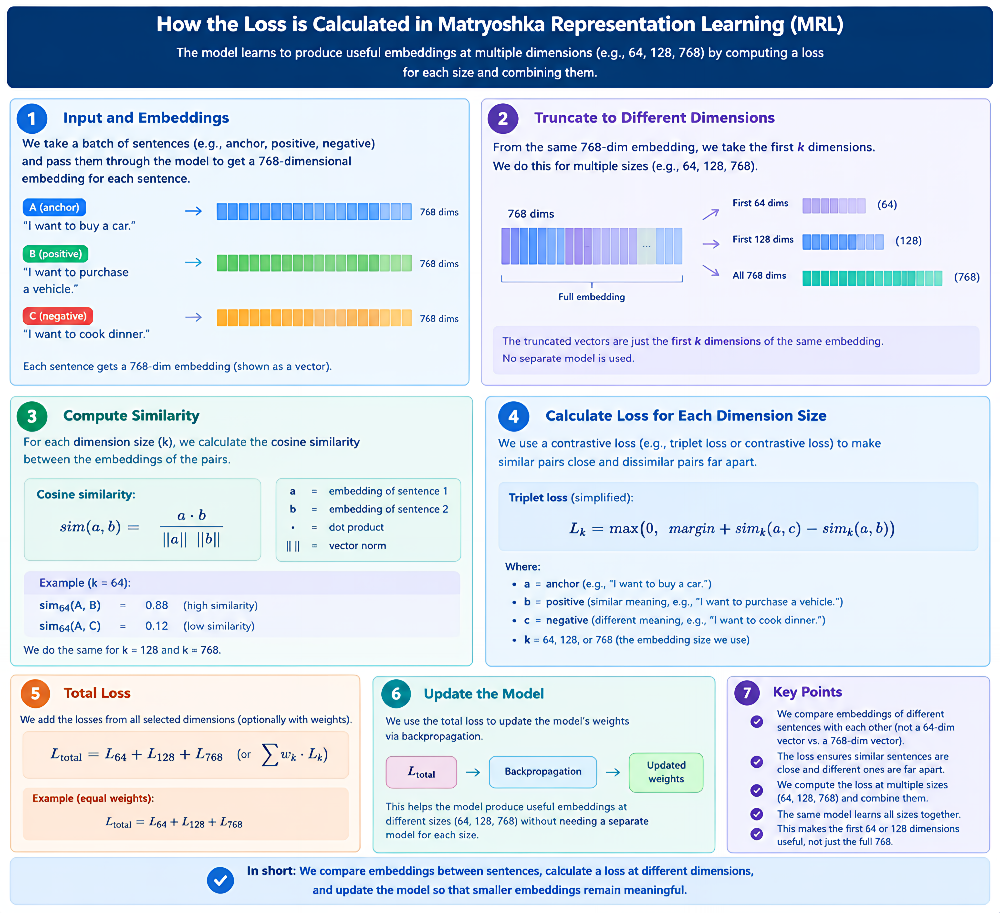

# 🪆 Matryoshka Representation Learning (MRL) Explained

> A simple, practical guide to flexible, high-efficiency vector embeddings used by modern models (e.g., OpenAI `text-embedding-3`, Nomic, and Hugging Face Sentence Transformers).

---

## 📌 Table of Contents

- [Part 1: What is Matryoshka Representation Learning?](#-part-1-what-is-matryoshka-representation-learning)
- [Part 2: How It Works Under the Hood](#-part-2-how-it-works-under-the-hood)
- [Part 3: Key Benefits & Practical Uses](#-part-3-key-benefits--practical-uses)
- [Part 4: Quick Implementation Example (Hugging Face)](#-part-4-quick-implementation-example-hugging-face)
- [Part 5: Why MRL Enhances Security & Privacy in RAG](#-part-5-why-mrl-enhances-security--privacy-in-rag)
- [Part 6: References](#-part-6-references)

---

<details open>
<summary><b>📖 Part 1: What is Matryoshka Representation Learning?</b></summary>

<br>

### The Russian Doll Analogy

Imagine a traditional **Russian nesting doll (Matryoshka)**: each doll fits inside a slightly larger one. No matter which layer you take off, you still have a complete doll.

**Matryoshka Representation Learning (MRL)** applies this exact idea to AI text embeddings:
- **Traditional Embeddings:** A fixed-length list of numbers (e.g., 1,536 dimensions). If you cut off the vector to save space, the embedding breaks and loses its semantic meaning.
- **Matryoshka Embeddings:** The model is trained so that the **first few dimensions** (e.g., 64 or 128) capture the broad, most important semantic meaning, while the remaining dimensions capture more details about the meaning.

### In Short:
> You can simply slice off the end of your vector (`vector[:128]`) to shrink its size by up to **8x–16x**, while retaining up to **95–99%** of the original retrieval accuracy!

</details>

---

<details>
<summary><b>⚙️ Part 2: How It Works Under the Hood</b></summary>

<br>

### Traditional Loss vs. Matryoshka Loss

| Embedding Type | Training Strategy | Truncation Behavior |
| :--- | :--- | :--- |
| **Traditional** | Calculates loss only once on the full vector (e.g., 768d). | Slicing damages retrieval accuracy severely. |
| **Matryoshka (MRL)** | Evaluates loss simultaneously across multiple prefix subsets (e.g., 64d, 128d, 256d, 512d, 768d). | Slicing at any target dimension works out of the box. |

During training, MRL forces the model to pack the highest-density semantic signals into the earliest dimensions, making each sub-vector a fully functioning, self-contained embedding.

```text
Full Vector (768 dimensions):
[ #1 .. #64 ]   -> High-level topic (e.g., "Medical Sciences")
[ #65 .. #256 ]  -> Subfield specifics (e.g., "Cardiology / Treatments")
[ #257 .. #768 ] -> Granular nuance (e.g., "Specific dosage & patient cohort")
```

*(Note: While 768d is standard for base models like MPNet and Nomic, larger models like OpenAI `text-embedding-3-small` / `large` use the exact same technique scaled to 1,536d or 3,072d).*

### 📊 Loss Calculation Architecture

The diagram below illustrates how multiple loss terms are computed across truncated dimensions during each forward pass and summed into a single total loss:

<p align="center">
  
</p>

</details>

---

<details>
<summary><b>🚀 Part 3: Key Benefits & Practical Uses</b></summary>

<br>

### 1. Two-Stage (Coarse-to-Fine) Retrieval

Instead of searching millions of full-size vectors:
1. **Pass 1 (Fast Shortlisting):** Search your database using small 64-dim or 128-dim vectors to shortlist top 50–100 candidate documents in milliseconds.
2. **Pass 2 (Precision Re-rank):** Re-rank only those top candidates using the full 768-dim vectors (or cross-encoder).
- **Result:** Drastically lower search latency and cloud compute costs while **retaining ~98%+ of original retrieval accuracy**.

<p align="center">
  
</p>

---

### 2. Drastic Memory & Storage Savings in Vector DBs
- Storing high-dimensional vectors in memory (RAM/VRAM) for index types like HNSW is expensive.
- Truncating from 768d to 128d (or 1,536d to 256d) yields an **~83% reduction** in storage and memory footprints in vector databases like Milvus, Zilliz, or Qdrant.

---

### 3. Adaptive Deployment (Edge to Cloud)
- **Low-power edge devices / mobile phones:** Store and run similarity search using tiny 64d vectors.
- **Powerful cloud servers:** Use the full-size 768d embeddings for complex analytics.
- **One model handles both:** You do not need to train or host separate models for mobile and server.


</details>

---

<details>
<summary><b>💻 Part 4: Quick Implementation Example (Hugging Face)</b></summary>

<br>

Using MRL embeddings with Hugging Face's `sentence-transformers` is as simple as slicing a NumPy array and re-normalizing:

```python
from sentence_transformers import SentenceTransformer
import torch.nn.functional as F
import torch

# Load a model that supports Matryoshka embeddings
model = SentenceTransformer("nomic-ai/nomic-embed-text-v1.5", trust_remote_code=True)

sentences = [
    "Matryoshka embeddings save memory and compute.",
    "Nested representations allow flexible vector truncation."
]

# 1. Produce the full 768-dimension embeddings
embeddings = model.encode(sentences, convert_to_tensor=True)
print("Original shape:", embeddings.shape)  # torch.Size([2, 768])

# 2. Truncate to 128 dimensions
truncated = embeddings[:, :128]

# 3. Always re-normalize after truncation for cosine similarity!
normalized_truncated = F.normalize(truncated, p=2, dim=1)
print("Truncated shape:", normalized_truncated.shape)  # torch.Size([2, 128])
```

</details>

---

<details>
<summary><b>🛡️ Part 5: Why MRL Enhances Security & Privacy in RAG</b></summary>

<br>

In Retrieval-Augmented Generation (RAG), vector embeddings are often mistakenly assumed to be private because they look like raw mathematical numbers. However, modern attacks prove otherwise.

Here is how Matryoshka embeddings directly strengthen the security posture of RAG pipelines:

### 1. Defense Against Embedding Inversion Attacks (EIA)
- **The Threat:** Attackers using generative decoders (like *Vec2Text*) can invert dense embeddings back into their original sensitive plaintext (PII, trade secrets, confidential medical notes).
- **The MRL Protection:** When vector indices store only truncated prefixes (e.g., 64d or 128d), the finer token-level reconstruction data is stripped out. Inversion algorithms cannot reconstruct exact quotes or granular private details from coarse-grained prefixes.

### 2. Reduced Cache and Data Exposure

- Smaller embeddings use less memory and require less data transfer.
- This can reduce the amount of data handled by the system.
- Combined with secure caching and memory management, this may help reduce some security risks.

- However, smaller embeddings alone do not prevent side-channel attacks.

</details>

---

<details>
<summary><b>📚 Part 6: References</b></summary>

<br>

1. **Zilliz Learn:** [Matryoshka Representation Learning Explained: The Method Behind OpenAI's Efficient Text Embeddings](https://medium.com/@zilliz_learn/matryoshka-representation-learning-explained-the-method-behind-openais-efficient-text-embeddings-a600dfe85ff8)
2. **Hugging Face Blog:** [Matryoshka Embeddings: Fast & Flexible Vector Search](https://huggingface.co/blog/matryoshka#%F0%9F%AA%86-matryoshka-embeddings)
3. **Original Research Paper:** *Matryoshka Representation Learning* (Kusupati et al., NeurIPS 2022).

</details>
